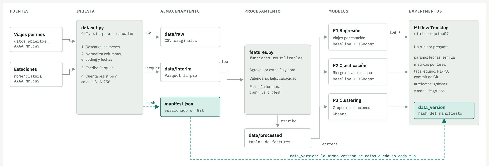

# MLOps-ProyectoMiBici-Equipo7

<a target="_blank" href="https://cookiecutter-data-science.drivendata.org/">
    
</a>

Proyecto integrador de **Operaciones de Aprendizaje Automático (MLOps, TC5061)** del Equipo 7. Propone y construye una solución de Machine Learning sobre los datos abiertos de **MiBici**, el sistema de bicicleta pública del Área Metropolitana de Guadalajara.

## Instalación

Requiere Python 3.11 y [uv](https://docs.astral.sh/uv/).

```bash
git clone https://github.com/sanchezdavilaluisarturo/MLOps-ProyectoMiBici-Equipo7.git
cd MLOps-ProyectoMiBici-Equipo7
uv venv --python 3.11 .venv
source .venv/bin/activate
make requirements        # uv pip install -r requirements.txt
```

## Ejecución

```bash
# Datos: descarga, normaliza, valida contra el manifiesto y limpia
make data

# P3: partición temporal, tablas de estaciones y demanda por estación-hora
make features

# P3: modelo base y modelo alternativo (con P3_REGISTRAR_MLFLOW=true registra los runs en MLflow)
make train

mlflow ui                                                # http://127.0.0.1:5000
```

### Datos, features y entrenamiento de P3

Cada etapa es un comando del módulo `tc5061_proyecto_equipo07` y tiene su notebook, que la llama y documenta los hallazgos (los notebooks se corren desde `notebooks/`):

| Orden | Comando | Notebook | Qué deja listo |
|---|---|---|---|
| 1 | `make data` (`dataset todo`) | `0.02-dsh-exploracion-carga`, `0.01-lasd-exploracion-carga` | CSV en `data/raw/`, Parquet normalizado en `data/interim/` y datos limpios en `data/processed/` |
| 2 | — | `0.02-lasd-eda-p3` | EDA de P3: calidad, tiempo y estaciones (solo hallazgos) |
| 3 | `make features` | `0.03-lasd-limpieza-p3` | `viajes_modelado_*.parquet` (con partición temporal), `estaciones_train.parquet` y `demanda_estacion_hora.parquet` |
| 4 | `make train` | `0.04-lasd-baseline-p3`, `0.05-lasd-mejoramodelo-p3` | Modelo base y modelo alternativo de P3, con artefactos en `reports/figures/p3_*` y, si se pide, runs en MLflow |

**Convención:** toda función que se agrega al módulo para P3 se llama `p3_<nombre>` (por ejemplo, `p3_perfil_de_estaciones`). Las funciones de `dataset.py` anteriores a P3 no se renombran: lo que subió el equipo solo se amplía.

**Variables de entorno.** El mismo comando corre en la terminal, en los notebooks y en GitHub Actions (`.github/workflows/p3.yml`); cada parámetro tiene también su opción de línea de comandos:

| Variable | Qué controla | Por defecto |
|---|---|---|
| `MLFLOW_TRACKING_URI` | URL del servidor MLflow (en CI, el secret del repositorio `secrets.MLFLOW_TRACKING_URI`) | `.env` |
| `MLFLOW_RUN_NAME` | Prefijo del nombre de los runs: `<valor>-baseline` y `<valor>-pca_kmeans` (en CI, `vars.MLFLOW_RUN_NAME`) | `baseline` y `pca_kmeans` |
| `P3_REGISTRAR_MLFLOW` | Escribir en MLflow | `false` |
| `P3_REGISTRAR_DE_NUEVO` | Crear un run nuevo aunque ya exista uno terminado con ese nombre | `false` |
| `P3_EXIGIR_ACEPTACION` | Salir con error si el modelo alternativo no cumple los criterios de aceptación | `false` |
| `P3_EXPERIMENTO` | Experimento de MLflow | `mibici-equipo07` (el de `config.py`) |
| `P3_SEMILLA`, `P3_K_MINIMO`, `P3_K_MAXIMO`, `P3_MIN_SALIDAS_TRAIN`, `P3_MIN_SALIDAS_VALID`, `P3_COMPONENTES`, `P3_SEMILLAS_BUSQUEDA` | Parámetros del modelo | `42`, `2`, `10`, `1000`, `300`, `3,4,5,6,8,10`, `5` |

**Pruebas:** `pytest tests`.

**GitHub Actions:** el workflow `p3.yml` corre `ruff` y `pytest` en los PR que tocan el módulo; el entrenamiento solo corre a mano (*Run workflow*), descarga los datos con caché por el hash del manifiesto y solo registra en MLflow si se marca `registrar`.

**MLflow del equipo:** https://mlflow.equipo7mlops.com/ (la URL se define en `MLFLOW_TRACKING_URI`). Los runs de la primera entrega (`baseline` y `pca_kmeans`) están en el experimento `p3`; desde ahora los comandos usan `mibici-equipo07`.

## Propósito

Responder con ML tres preguntas operativas de MiBici, sobre una base reproducible (ingesta versionada, features reutilizables y experimentos registrados en MLflow) que las siguientes entregas del curso extenderán.

## Preguntas del proyecto

| # | Pregunta de negocio | Tarea | Usuario |
|---|---|---|---|
| P1 | ¿Cuántos viajes se iniciarán en una estación o zona en un periodo futuro? | Regresión | Operador del sistema (planeación de flota) |
| P2 | ¿Una estación estará en riesgo de quedarse sin bicicletas o sin anclajes? | Clasificación | Equipo de rebalanceo |
| P3 | ¿Qué grupos de estaciones comparten patrones de uso y dónde se ubican? | Clustering | Planeación urbana y expansión |

> Los datos no incluyen inventario de bicicletas por estación; para P2 el riesgo se aproxima con el balance neto de viajes (salidas − llegadas) acumulado frente a la capacidad de la estación.

Detalle de cada pregunta (qué se predice, relevancia y decisión que habilita): [ML Canvas](references/ml-canvas.md).

## Datos

### Fuente

[Datos abiertos de MiBici](https://mibici.net/es/datos-abiertos/), sistema de bicicleta pública del Área Metropolitana de Guadalajara. El portal publica **solo CSV**:

- **Viajes:** `datos_abiertos_AAAA_MM.csv`, un archivo por mes desde dic-2014 (140 archivos publicados al 15-oct-2026).
- **Estaciones:** `nomenclatura_AAAA_MM.csv`, una sola versión vigente (`nomenclatura_2026_09.csv`).
- Los datos **no se versionan en Git** (ver `.gitignore`); se reconstruyen desde el portal y se convierten a Parquet (ver `dataset.py` y los notebooks `0.02-dsh` y `0.01-lasd`).
- **Enlaces, registros y SHA-256 de cada archivo:** [`references/fuentes-datos.csv`](references/fuentes-datos.csv).

### Alcance del análisis

| Concepto | Valor |
|---|---|
| Rango acordado por el equipo | enero 2020 a septiembre 2026 |
| Viajes | **26,389,162** en 79 archivos mensuales |
| Primer y último inicio de viaje | 2020-01-01 06:02:20 a 2026-09-30 23:59:48 |
| Usuarios distintos | 81,115 |
| Estaciones en los viajes | 475 (de 484 en la nomenclatura) |
| Mes con menos viajes | 2020-04 (129,276), inicio de la pandemia de COVID-19 |
| Mes con más viajes | 2026-09 (490,056) |
| Tamaño | 2.1 GB en CSV, 0.6 GB en Parquet |

> **Meses faltantes:** 2023-04 y 2023-05 ya no están publicados en el portal (se publicaban el 13-oct-2026 y desaparecieron sin aviso). El análisis trabaja con 79 de los 81 meses del rango y el hueco se tratará en la limpieza.

Viajes por año (2026 llega solo hasta septiembre):

| 2020 | 2021 | 2022 | 2023* | 2024 | 2025 | 2026 |
|---:|---:|---:|---:|---:|---:|---:|
| 2,866,072 | 3,184,410 | 4,202,942 | 3,595,720 | 4,645,921 | 4,532,032 | 3,362,065 |

\* 2023 no incluye abril ni mayo.

### Esquema de viajes

| Columna (CSV original) | Columna en Parquet | Tipo | Nulos | Descripción |
|---|---|---|---:|---|
| `Viaje_Id` | `viaje_id` | entero | 0 | Identificador del viaje |
| `Usuario_Id` | `usuario_id` | entero | 0 | Identificador del usuario (anonimizado) |
| `Genero` | `genero` | categoría (`M`, `F`) | 135,232 (0.51 %) | Género del usuario |
| `Año_de_nacimiento` | `anio_de_nacimiento` | entero | 33,796 (0.13 %) | Año de nacimiento |
| `Inicio_del_viaje` | `inicio_del_viaje` | fecha y hora | 0 | Inicio del viaje |
| `Fin_del_viaje` | `fin_del_viaje` | fecha y hora | 0 | Fin del viaje |
| `Origen_Id` | `origen_id` | entero | 0 | Estación de origen |
| `Destino_Id` | `destino_id` | entero | 0 | Estación de destino |

### Esquema de estaciones

| Columna | Tipo | Descripción |
|---|---|---|
| `id` | entero | Identificador de la estación (único, de 2 a 519) |
| `name` | texto | Código y cruce de calles, por ejemplo `(GDL-001) C. Epigmenio Glez./ Av. 16 de Sept.` |
| `latitude`, `longitude` | decimal | Ubicación (entre 20.636 y 20.740 N, y entre -103.433 y -103.297 O) |
| `dpcapacity` | entero | Capacidad en anclajes; promedio 16.9, de 0 a 39, **8,171 anclajes en total** |

La nomenclatura tiene **484 estaciones** sin nulos.

### Hallazgos de calidad

Detectados en el EDA. El tratamiento aplicado a cada uno se documenta en *Limpieza y partición*, más abajo.

| Hallazgo | Evidencia | Notebook |
|---|---|---|
| **Nombre de columna corrupto** | 2024-02 y 2024-05 traen `A}äe_nacimiento` en lugar de `Año_de_nacimiento` | 0.02-dsh |
| **Codificación mezclada** | 43 archivos (53.1 %) en latin-1 y 38 (46.9 %) en UTF-8, sin regla por fecha | 0.02-dsh |
| **Formatos de fecha mezclados** | 78 archivos `AAAA-MM-DD hh:mm:ss`; 2023-11, 2024-09 y 2024-10 usan `DD/MM/AAAA hh:mm` | 0.02-dsh |
| **Viajes duplicados** | 758 filas completamente repetidas (1,516 filas comparten un `viaje_id` repetido) | 0.02-dsh, 0.02-lasd |
| **Años de nacimiento imposibles** | 1,255 anteriores a 1900 (mínimo 1) y 2,101 posteriores a 2010 (máximo 2023) | 0.01-fat |
| **Duración cero** | 55,035 viajes con inicio igual a fin | 0.02-lasd |
| **Duración extrema** | 159 viajes de más de 24 horas (máximo 469 horas, cerca de 20 días); la mediana es 9.4 min y el percentil 99, 32.8 min | 0.01-fat, 0.02-lasd |
| **Estaciones sin nomenclatura** | 3 ids (124, 405 y 407) aparecen en viajes y no en la nomenclatura: afecta a 3,961 viajes | 0.01-fat, 0.02-lasd |
| **Estaciones sin capacidad** | 4 estaciones con `dpcapacity = 0`, que afecta el cálculo de riesgo de P2 | 0.02-lasd |
| **Nomenclatura única** | Solo existe la versión 2026-09; estaciones retiradas o reubicadas no se pueden reconstruir para años anteriores | 0.02-dsh |
| **Sin servicio de madrugada** | Solo 194 viajes entre la 1:00 y las 4:59 (0.0007 %); la hora 0 tiene 145,857 (0.5 %) | 0.02-lasd |
| **Estaciones nuevas** | 109 estaciones no tienen viajes en entrenamiento y aparecen en prueba (3.8 % de sus viajes); 12 de la nomenclatura no registran ninguno | 0.03-lasd |
| **Capacidad sin relación con la demanda** | Correlación de Spearman entre salidas y capacidad de −0.02 | 0.02-lasd |
| **Demanda concentrada** | El 10 % de las estaciones (48) concentra el 37.8 % de los viajes; 74 tienen menos de 1,000 salidas | 0.02-lasd |
| **Sin inventario de bicicletas** | Los datos no registran bicis por estación (ver nota en Preguntas) | — |

### Privacidad

Los viajes incluyen `usuario_id`, género y año de nacimiento. Son datos personales aunque estén anonimizados; no se publican valores individuales en los notebooks ni en este README, solo agregados.

Rango de fechas y su justificación, variables y construcción de cada objetivo, condiciones de uso publicadas por MiBici y estrategia de partición temporal: [Definición de los datos](references/definicion-datos.md).

### Patrones del EDA

| Tema | Hallazgo |
|---|---|
| **Tendencia** | El promedio mensual crece de 238,839 viajes (2020) a 387,160 (2024) y se estabiliza: 377,669 en 2025 y 373,563 en 2026 |
| **Pandemia** | Cae de 367,864 viajes (feb-2020) a 129,276 (abr-2020), −64.9 %; el nivel de feb-2020 se supera hasta mar-2022 |
| **Días laborales** | Dos picos: 8:00 (8.3 % de los viajes) y 18:00 (10.5 %) |
| **Fin de semana** | Un solo pico amplio entre 11:00 y 14:00; sábado y domingo concentran el 20.4 % de los viajes |
| **Desbalance** | Acumulan bicicletas estaciones del centro (GDL-049, +148,627) y pierden las de Av. Vallarta (GDL-127, −98,030) |
| **Pendiente** | 2026-09 (490,056) es el máximo de la serie y +30 % contra 2025-09; falta verificar que no sea una carga atípica |

### Limpieza y partición

Reglas aplicadas por `dataset.limpiar` y documentadas en `0.03-lasd-limpieza-p3`, cada una con su justificación en el notebook:

| Hallazgo | Decisión | Registros |
|---|---|---:|
| Viajes con `viaje_id` repetido (filas idénticas) | Eliminar | 758 |
| Origen o destino sin nomenclatura | Excluir | 3,961 |
| Duración cero | Excluir (sensibilidad por probar en el modelado) | 55,034 |
| Duración mayor a 24 h | Excluir | 159 |
| `usuario_id`, `genero`, `anio_de_nacimiento` | Descartar (minimización de datos personales) | — |
| Meses sin datos (hoy ninguno: el portal volvió a publicar 2023-04 y 2023-05); horas 1:00 a 4:59 | No imputar; excluir de la tabla de demanda | — |

**Resultado:** 59,912 registros retirados (0.221 %); quedan **27,026,645 viajes** en `data/processed/viajes_limpios_2020-01_2026-09.parquet`. Para el modelado, `dataset p3-particionar` deja `data/processed/viajes_modelado_2020-01_2026-09.parquet` solo con las columnas que usan las preguntas (sin `usuario_id`, género ni año de nacimiento) y con la partición.

**Partición temporal** con una brecha de 24 horas antes de cada frontera, para que ninguna etiqueta use datos del conjunto siguiente:

| Conjunto | Periodo | Viajes | % |
|---|---|---:|---:|
| train | 2020-01-01 a 2024-09-29 | 17,987,077 | 66.6 |
| valid | 2024-10-01 a 2025-09-29 | 4,520,744 | 16.7 |
| test | 2025-10-01 a 2026-09-30 | 4,489,362 | 16.6 |
| brecha | 24 h antes de cada frontera | 29,462 | 0.1 |

**Preprocesamiento:** `data/processed/estaciones_train.parquet` (484 estaciones, calculada solo con entrenamiento) y `data/processed/demanda_estacion_hora.parquet` (16,179,853 filas para 472 estaciones; 44.2 % de las estación-horas sin viajes), generadas por `features p3-features`.

## Arquitectura



| Componente | Herramienta | Justificación |
|---|---|---|
| Ingesta (CLI) | Python + Typer + loguru | Comando único, sin pasos manuales |
| Almacenamiento | Parquet (pyarrow) | Columnar y comprimido para millones de viajes |
| Versionado de datos | Manifiesto JSON + `hashlib` en Git | Trazabilidad simple: nº de registros y SHA-256 por archivo |
| Procesamiento | pandas | Suficiente para agregados por estación/hora |
| Modelado | scikit-learn, XGBoost, Optuna | Baselines y candidatos para regresión, clasificación y clustering |
| Experimentos | MLflow Tracking | Parámetros, métricas, tags (equipo, pregunta, commit) y artefactos |

Etapas por pregunta (limpieza, agregaciones, features, entrenamiento y evaluación): [Diseño del pipeline de ML](references/pipeline-ml.md).

## Modelo base de P3 (clustering de estaciones)

Notebook `0.04-lasd-baseline-p3` (código en `modeling/train.py`). K-Means sobre variables estandarizadas, ajustado solo con el conjunto de entrenamiento.

| Elemento | Valor |
|---|---|
| **Estaciones agrupadas** | 362 (con al menos 1,000 salidas en entrenamiento) |
| **Variables** | 44: perfil horario laboral y de fin de semana (20 horas de servicio cada uno), volumen diario, balance neto sobre salidas, proporción de viajes circulares y duración mediana |
| **`k`** | 2, elegido por silueta entre 2 y 10 |
| **Silueta** | 0.145 (estructura débil: los grupos se solapan) |
| **Davies-Bouldin / Calinski-Harabasz** | 2.12 / 69.2 |
| **Estabilidad (ARI con el año de validación)** | 0.66; 34 de 359 estaciones (9.5 %) cambian de grupo |

| Grupo | Estaciones | Perfil | Volumen mediano |
|---|---:|---|---|
| 0 | 202 | Pico matutino a las 8:00 (10.7 % de las salidas laborales); más periférico (3.0 km del centro de la red); balance +2.9 % | 19.8 viajes por día |
| 1 | 160 | Pico vespertino a las 18:00 (12.6 %); más cerca del centro (2.2 km) y al poniente; tiende a perder bicicletas (−9.3 %) | 29.4 viajes por día |

**Límites:** con `k = 2` la granularidad no basta para decidir ampliaciones o reubicaciones, y la separación se explica casi solo por horario y volumen. Las 109 estaciones nuevas quedan fuera del agrupamiento. Las etiquetas 0 y 1 de K-Means son arbitrarias y pueden invertirse entre corridas. Siguientes pasos: HDBSCAN o mezclas gaussianas. La lectura "residencial frente a zonas de trabajo" es una hipótesis por verificar.

### Modelo alternativo de P3

Notebook `0.05-lasd-mejoramodelo-p3`. PCA sobre las mismas variables y K-Means con `k` de 3 a 6, con criterios de aceptación fijados antes de ver los resultados y cinco semillas por configuración. Resultado con los 81 meses: **no se acepta**.

| Criterio | Baseline (`k = 2`) | Alternativo (`k = 3`, 5 componentes) | ¿Cumple? |
|---|---|---|---|
| Silueta (espacio estandarizado del baseline) | 0.145 | 0.140 | No |
| Estabilidad (ARI con validación) | 0.656 | 0.676 | Sí |
| Estaciones del grupo más chico | 160 | 42 | Sí (mínimo 20) |

A igual `k` (`k = 3`) tampoco hay ventaja clara: el baseline logra ARI 0.689 y grupo mínimo de 68. El valor del alternativo es interpretativo: separa un perfil intermedio de 68 estaciones de uso mixto que el `k = 2` esconde.

### Registro en MLflow

- **Servidor:** la URL de `MLFLOW_TRACKING_URI` (https://mlflow.equipo7mlops.com/) · **Experimento:** `mibici-equipo07` (el de `config.py`) · **Runs:** `baseline` y `pca_kmeans`, o `<MLFLOW_RUN_NAME>-baseline` y `<MLFLOW_RUN_NAME>-pca_kmeans`.
- **Cuándo se registra:** solo con `P3_REGISTRAR_MLFLOW=true`; es idempotente (un run terminado con el mismo nombre no se duplica, y uno que quedó a medias no cuenta).
- **Registrado:** 14 parámetros, 11 métricas, etiquetas (equipo, pregunta, commit, autor), artefactos (asignación por estación, resumen de grupos, mapa y silueta por `k`) y el modelo (`StandardScaler` + `KMeans`).
- **Trazabilidad:** el parámetro `data_version` es `dataset.version_datos()` (hash de los SHA-256 de `references/fuentes-datos.csv`); en CI las etiquetas incluyen `github_run_id`, `github_actor`, `github_ref_name` y el commit.
- **Copia local:** los mismos artefactos se guardan en `reports/figures/p3_*` y sí se versionan en Git.

> **Al crear un experimento nuevo en este servidor, usar `artifact_location="mlflow-artifacts:/<nombre>"`.** Sin esa opción el servidor asigna una ruta local suya (`/home/ec2-user/mlflow/artifacts/...`) y la subida de artefactos falla con `Errno 45`. El servidor es MLflow 3.1.4 y el `requirements.txt` fija el cliente en 3.16.0: conviene alinearlos.

## Estructura de carpetas

```
├── data/              <- (ignorado por Git)
│   ├── raw/           <- CSV originales del portal (viajes/ y estaciones/)
│   ├── external/      <- Parquet mensuales por viaje
│   ├── interim/       <- viajes_2020-01_2026-09.parquet (normalizado, sin limpiar)
│   └── processed/     <- viajes_limpios_*, viajes_modelado_*, estaciones_train y demanda_estacion_hora (.parquet)
├── docs/              <- Documentación (mkdocs)
├── models/            <- Modelos serializados (ignorado por Git)
├── notebooks/         <- Convención FASE.NUMERO-INICIALES-descripcion.ipynb
│   ├── 0.01-fat-exploracion-inicial.ipynb    <- EDA sobre Parquet: nulos, años de nacimiento, duración y conteo de entradas/salidas por estación
│   ├── 0.01-lasd-exploracion-carga.ipynb     <- P3, Paso 1: carga y descripción del dataset con dataset.py
│   ├── 0.02-dsh-exploracion-carga.ipynb      <- Descarga del portal, inventario por archivo (codificación, esquema, fechas), unión y Parquet
│   ├── 0.02-lasd-eda-p3.ipynb                <- P3, Paso 2: EDA (calidad, tiempo y estaciones)
│   ├── 0.03-lasd-limpieza-p3.ipynb           <- P3, Paso 3: limpieza, partición temporal y preprocesamiento
│   ├── 0.04-dsh-eda-p1.ipynb                 <- EDA de P1
│   ├── 0.04-lasd-baseline-p3.ipynb           <- P3, Paso 4: modelo base y registro en MLflow
│   └── 0.05-lasd-mejoramodelo-p3.ipynb       <- P3, Paso 4: modelo alternativo, comparación y registro en MLflow
├── references/        <- Documentos de diseño
│   ├── ml-canvas.md          <- ML Canvas y descripción de P1, P2 y P3
│   ├── definicion-datos.md   <- Rango, fuente, variables, objetivos, condiciones de uso y partición
│   ├── pipeline-ml.md        <- Pipeline por pregunta: limpieza, features, entrenamiento y evaluación
│   ├── pipeline-ml.png       <- Diagrama del pipeline por pregunta (fuente editable: pipeline-ml.svg)
│   ├── fuentes-datos.csv     <- URLs, registros y SHA-256 de los archivos del portal
│   └── arquitectura.png      <- Diagrama de arquitectura
├── reports/figures/   <- Gráficas y tablas generadas (p3_asignacion_grupos.csv, p3_resumen_grupos.csv, p3_variables.json, p3_mapa_grupos.png, p3_silueta_por_k.png)
├── tc5061_proyecto_equipo07/   <- Módulo: config.py, dataset.py, features.py, modeling/ (train.py, predict.py), plots.py
├── tests/             <- Pruebas (pytest) de las funciones p3_*
├── .github/workflows/p3.yml   <- Calidad en los PR y entrenamiento manual de P3
├── Makefile
├── pyproject.toml
└── requirements.txt   <- Dependencias con versiones fijadas
```

## Flujo de trabajo con Git (GitHub Flow)

- `main` está protegida: todo cambio entra por Pull Request con al menos una revisión.
- Ramas desde `main`: `feat/<tema>`, `fix/<tema>`, `docs/<tema>`, `chore/<tema>`.
- Commits con [Conventional Commits](https://www.conventionalcommits.org/): `feat:`, `fix:`, `docs:`, `config:`, `refactor:`.
- Cada integrante abre al menos un PR y revisa al menos uno de otro integrante.

## Equipo

| Integrante | Matrícula | Rol |
|---|---|---|
| Daniel Sánchez Hernández | A01840324 | *por definir* |
| Luis Arturo Sánchez Davila | A01840576 | *por definir* |
| Fernando Arreola Treviño | A01840331 | *por definir* |
